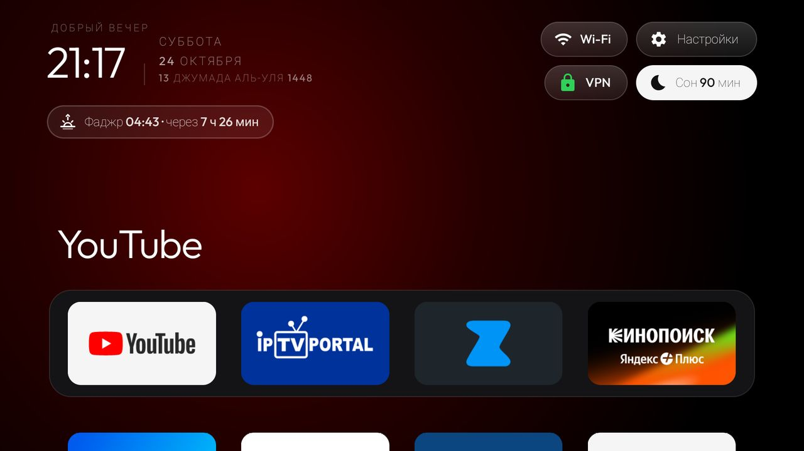
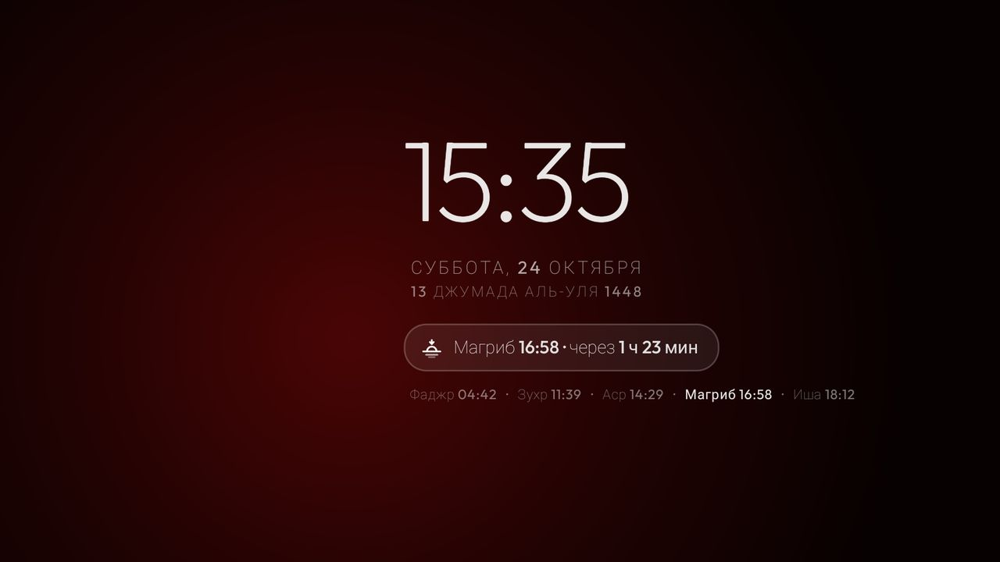
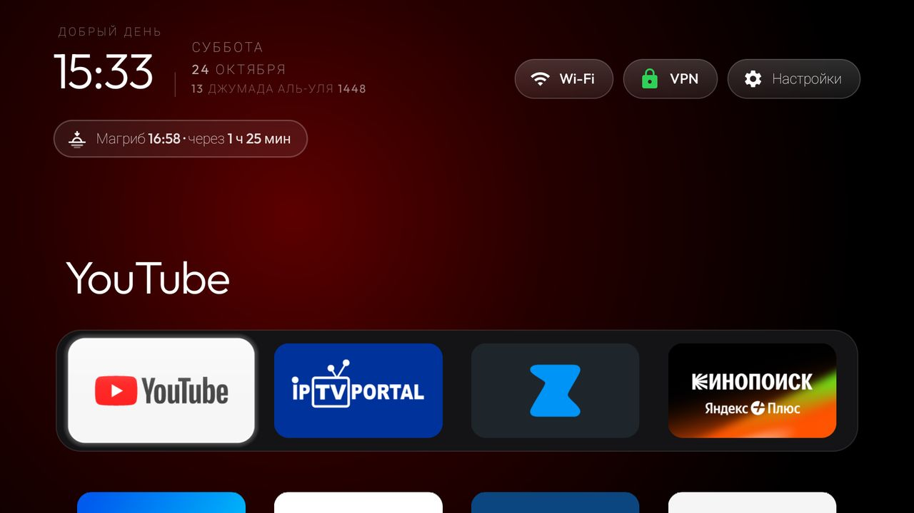
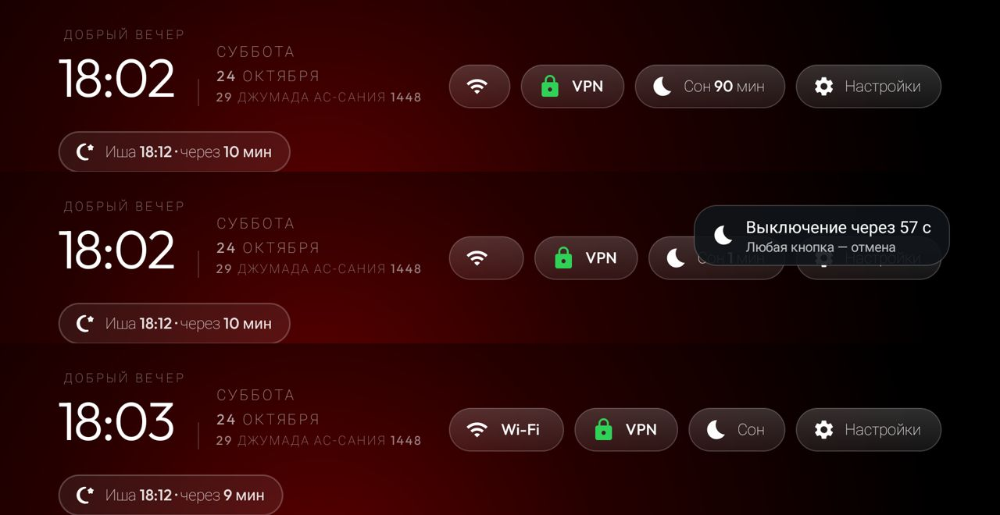

# tv-setup: Android TV-приставка одним промтом

Чистый главный экран для Android TV и Google TV со временем намаза, датой по хиджре, заставкой, таймером сна,
VPN-пилюлей и доком из любимых приложений. Плюс ByeByeDPI, чтобы YouTube работал. Всё ставится по Wi-Fi, без
root и прошивки, с откатом одной командой. Настраивает агент (Claude Code) по скиллу
[`skills/tv-setup`](skills/tv-setup/SKILL.md): у вас он спросит только город и какие приложения не нужны.

<p align="center">
  
</p>

## Это форк cleanyourtv

Основа — [**cleanyourtv**](https://github.com/Gathin23/cleanyourtv) Gathin23 и его участников (лицензия MIT).
Оттуда инструменты для отключения рекламы и телеметрии без удаления, правила безопасности, лаунчер в стиле Apple TV
и сотни проверенных списков для конкретных моделей ТВ. Спасибо автору и всем, кто присылал списки. Исходное
описание проекта — [README.upstream.md](README.upstream.md).

Форк сделан от коммита `cc4c7c59` апстрима. С тех пор апстрим ушёл примерно на 336 коммитов вперёд, этот репо на
них не перебазирован. Свежие списки моделей и исправления лаунчера смотрите в апстриме.

## Что добавлено

| | |
|---|---|
| **Время намаза** | Строка под часами: «Аср 14:29 · через 1 ч 12 мин». В момент намаза — маленькая плашка поверх любого приложения на минуту, пульт она не перехватывает. 27 официальных таблиц муфтията Дагестана и оффлайн-генератор для любого города ([подробнее](docs/tv-setup/prayer-times.md)). Сетевых запросов в лаунчере нет. |
| **Дата по хиджре** | Третья строка под датой, календарь Умм аль-Кура: «13 джумада аль-уля 1448». |
| **Заставка «Намаз»** | Часы, обе даты, следующий намаз и все пять времён дня. Блок раз в минуту переезжает на новое место, чтобы экран не выгорал. |
| **Таймер сна** | Пилюля «Сон»: 15 → 30 → 60 → 90 минут. За минуту до конца — отсчёт поверх приложения, любая кнопка пульта отменяет. Потом приставка уходит в standby. |
| **VPN-пилюля** | Показывает, включён ли VPN (зелёный замок). Выключает VPN любого приложения одним нажатием, включает последнее VPN-приложение. |
| **Авто-док** | Первый ряд — самые используемые за 14 дней приложения. Настройки и VPN-приложения в него не попадают. |
| **Сетка пилюль** | 2×2 справа сверху: Wi-Fi и Настройки, под ними VPN и Сон. Навигация пультом по рядам. |
| **ByeByeDPI** | [ByeByeDPI](https://github.com/romanvht/ByeByeDPI) для YouTube: проверка хеша и подписи релиза, стратегия, белый список только YouTube для ТВ, автозапуск. |

<p align="center">
  
  
</p>
<p align="center">
  
</p>

## Одним промтом

Понадобятся компьютер в той же Wi-Fi-сети, что и ТВ, и [Claude Code](https://claude.com/claude-code). Откройте
Claude Code в пустой папке и вставьте:

```
Склонируй https://github.com/becandier/tv-setup и настрой мой телевизор по skills/tv-setup/SKILL.md.
```

Агент:

- найдёт ТВ в сети и подскажет, как включить на нём отладку;
- сделает резерв;
- спросит город и ненужные приложения;
- отключит выбранное, соберёт и поставит лаунчер, поставит ByeByeDPI;
- всё проверит скриншотами с ТВ.

С пульта нужно будет:

- включить отладку;
- подтвердить ключ компьютера.

ByeByeDPI агент настраивает сам, включая согласие на VPN.

Повторный запуск на уже настроенном ТВ ничего не ломает: каждый шаг проверяет, что уже сделано.

Работает на Android TV и Google TV (Xiaomi, TCL, Hisense, Sony, Philips, Nvidia Shield и другие) с Android 8 и
новее. Не работает на Samsung (Tizen), LG (webOS) и Fire TV.

## Вручную

Всё, что делает агент, — это скрипты из `tools/` и `launcher/`. Их можно запускать самому:

```sh
python3 -m venv tools/venv && tools/venv/bin/pip install -r tools/requirements.txt
export TV_HOST=192.168.1.50                      # IP вашего ТВ
tools/tv-backup.sh                               # резерв, первый снимок — точка отката
tools/disable.sh my-list.txt                     # отключить пакеты из списка (по одному в строке)
PRAYER_CITY=makhachkala HOME_KEY_SERVICE=1 PRAYER_OVERLAY=1 VPN_PILL=1 USAGE_DOCK=1 SLEEP_TIMER=1 PRAYER_DREAM=1 \
  launcher/build-and-install.sh                  # лаунчер; нужны JDK 17 и Android SDK
tools/byedpi.sh                                  # ByeByeDPI для YouTube
tools/tv-tweaks.sh                               # анимации 0.5, очистка кешей
```

**Город.** `PRAYER_CITY` — slug из [`prayer-tables/index.json`](prayer-tables/index.json): `makhachkala`,
`derbent`, `khasavyurt`, `kaspiysk` и ещё 23 города и района Дагестана. Для другого города таблицу считает
генератор:

```sh
tools/prayer_table.py --city kazan --name "Казань" --lat 55.7963 --lon 49.1088 --tz Europe/Moscow --method russia
PRAYER_CITY=kazan ... launcher/build-and-install.sh
```

Методы — `mwl` (по умолчанию), `isna`, `egypt`, `umm-al-qura`, `russia` (ДУМ РФ), `dagestan`; аср шафиитский или
ханафитский (`--asr hanafi`). С расписанием местной мечети расчёт может расходиться на несколько минут, таблица
расхождений — в [docs/tv-setup/prayer-times.md](docs/tv-setup/prayer-times.md). Без `PRAYER_CITY` лаунчер
собирается без намаза.

**ByeByeDPI.** Стратегия в `tools/byedpi.sh` подобрана под одного провайдера и может не подойти вашему. Как
подобрать свою — в [references/byedpi.md](skills/tv-setup/references/byedpi.md).

## Откат

```sh
TV_HOST=192.168.1.50 tools/tv-restore.sh backup/original-<модель> --dry-run   # посмотреть план
TV_HOST=192.168.1.50 tools/tv-restore.sh backup/original-<модель>             # вернуть
```

Откат:

- включает всё, что было отключено после резерва;
- возвращает удалённые для пользователя пакеты;
- возвращает стоковый Home, анимации, прежнюю заставку, геолокацию и accessibility-помощники.

Лаунчер и ByeByeDPI остаются установленными, но больше ничем не управляют. Удалить их — `pm uninstall
com.gathin.tvhome` и `pm uninstall io.github.romanvht.byedpi`. Отключение по списку откатывается и отдельно:
`tools/restore.sh <тот же список>`.

После настройки выключите на ТВ отладку по сети и отзовите ключи. Порт ADB 5555 открытый, без шифрования.
Проверка: `tools/venv/bin/python -I tools/adb-closed.py <ip>`.

## Приватность

- Лаунчер не ходит в сеть: у него нет разрешения `INTERNET`.
- Таблица намаза кладётся в APK при сборке.
- Резервы (`backup/`), скриншоты (`shots/`) и ключ ADB (`tools/adbkey/`) в `.gitignore`: в них серийники, имена
  сетей и устройства.
- IP телевизора передаётся только через `TV_HOST` и нигде не сохраняется.

## Для агентов и разработчиков

Агенту, открывшему репозиторий, нужно начать с [AGENTS.md](AGENTS.md): там правила безопасности и скилл
`tv-setup`. Проверки — `cd launcher && ./gradlew test lintRelease assembleRelease` и
`python3 -m unittest discover -s tests`.

## Лицензия

MIT, как у апстрима: [LICENSE](LICENSE). ByeByeDPI — отдельное приложение под GPL-3.0, скачивается с релизов
автора и в репо не входит. Таблицы намаза — официальные расписания муфтията Республики Дагестан.
